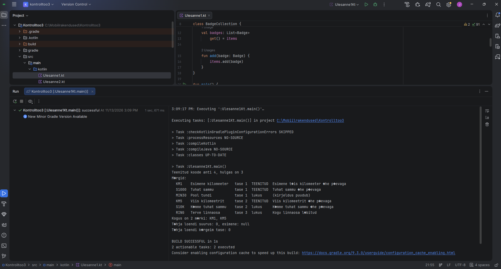
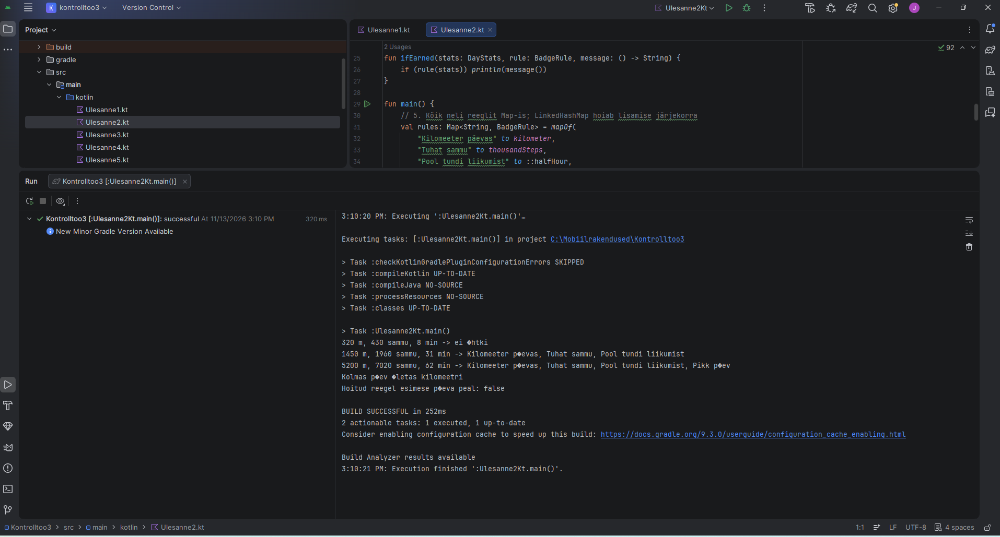
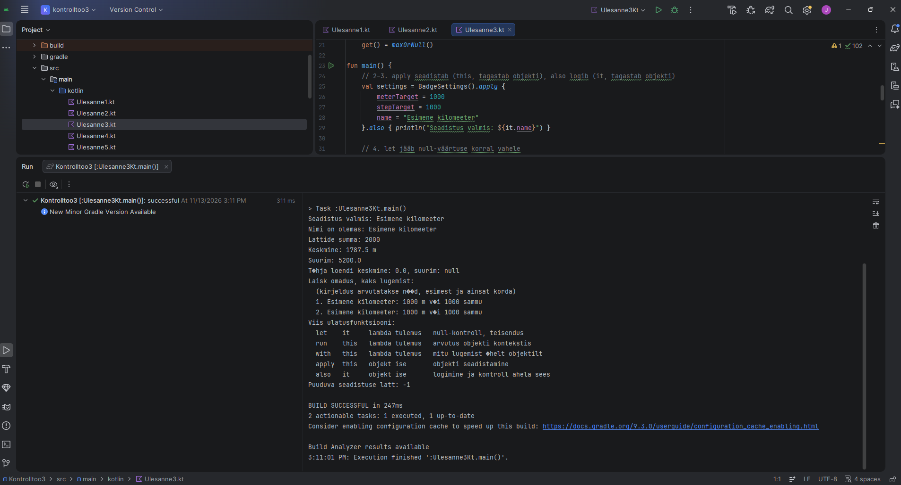
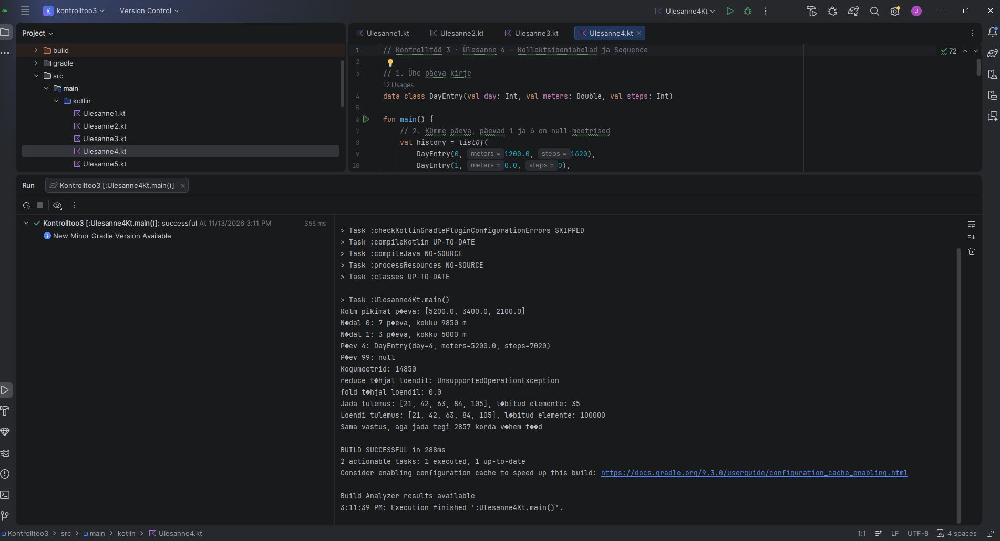
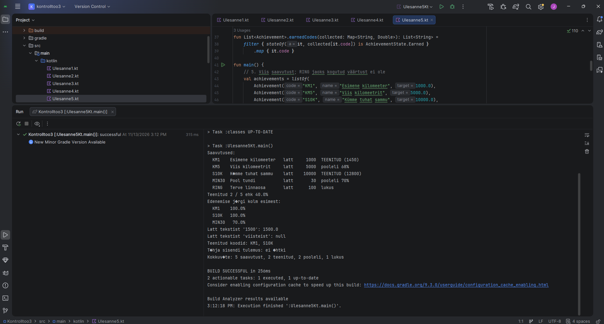

# Kontrolltöö 3 — Kotlin funktsionaalselt

Puhas Kotlin/JVM projekt. Iga ülesanne on eraldi failis `src/main/kotlin/UlesanneN.kt` oma `main`-funktsiooniga. Käivitamine: Android Studios roheline ▶ `fun main()` kõrval või käsurealt `gradle run -Pk=Ulesanne4Kt`.

Kõigi viie programmi väljund ühtib ülesande oodatava väljundiga tähemärgi täpsusega.

## Ülesanne 1 — Märgid kolmes kollektsioonis

Fail: [`Ulesanne1.kt`](src/main/kotlin/Ulesanne1.kt)

- **List** (`all`) hoiab märgid kindlas järjekorras; **Set** (`earned`) vastab küsimusele „kas on teenitud“ — `KM1` anti kaks korda, hulka jäi üks; **Map** (`descriptions`) seob koodi kirjeldusega.
- Puuduv kirjeldus: `descriptions[code]` annab `null` ja elvis `?: "(kirjeldus puudub)"` asendab selle — `if`-lauset ei ole vaja.
- `BadgeCollection` hoiab sees `private val items = mutableListOf()`, aga väljapoole annab `val badges: List<Badge>`. `List`-il ei ole `add`-i, seega rida `fromOutside.add(...)` ei kompileeru — kogu sisemist olekut ei saa väljast rikkuda.
- `emptyList()` on päris loend: `size` on 0, `firstOrNull()` annab `null`, `maxOfOrNull` koos elvisega annab 0. Ükski neist ei viska erindit.

## Ülesanne 2 — Märgireegel on väärtus

Fail: [`Ulesanne2.kt`](src/main/kotlin/Ulesanne2.kt)

- `typealias BadgeRule = (DayStats) -> Boolean` annab funktsioonitüübile nime. Reegel on VÄÄRTUS: teda saab panna `Map`-i, muutujasse (`held`) ja anda argumendiks.
- Kolm reeglit on lambdad, „pool tundi“ on tavaline funktsioon, mis antakse edasi viitena `::halfHour`.
- **`it` vs nimega parameeter:** `{ it.meters >= 1000.0 }` — ühe parameetri korral on nimi automaatselt `it`, sobib lühikesse lambdasse. `{ day -> day.steps >= 1000 }` — nimega parameeter on pikemas või pesastatud lambdas loetavam ja väldib it-ide segiajamist.
- `earnedBy` filtreerib reeglite `Map`-i ja tagastab sobivate võtmete nimekirja; `mapOf` hoiab lisamise järjekorra.
- `ifEarned(..., message: () -> String)` — teade on funktsioon, mitte valmis string, seega arvutatakse ta AINULT siis, kui reegel kehtib. Kutse `ifEarned(day, rule) { "..." }` kasutab viimase parameetri süntaksit.

## Ülesanne 3 — Ulatusfunktsioonid ja laiendused

Fail: [`Ulesanne3.kt`](src/main/kotlin/Ulesanne3.kt)

- `apply` seadistab objekti (`this`, tagastab objekti), `also` logib ahela sees (`it`, tagastab objekti), `let` jääb `null` korral vahele, `with` loeb mitu välja ja tagastab arvutuse, `?.run { } ?: -1` töötab nullitava objekti peal.
- Laiendused `List<Double>.mean()` ja `List<Double>.largest` lisavad standardtüübile funktsiooni ilma pärimiseta; tühjal loendil annavad 0.0 ja `null`, mitte erindit.
- `by lazy`: kirjeldus arvutatakse esimesel lugemisel (sulgudes teade trükitakse üks kord), teisel lugemisel tuleb väärtus meelest.

## Ülesanne 4 — Kollektsiooniahelad ja Sequence

Fail: [`Ulesanne4.kt`](src/main/kotlin/Ulesanne4.kt)

- Ahel `filter → map → sortedDescending → take(3)`: iga samm teeb ühte asja ja on ühe sõnaga nimetatav, seega saab iga rida eraldi kontrollida. Järjekord on oluline: kitsenda enne, järjesta siis, lõika lõpus.
- `groupBy { it.day / 7 }` annab nädala järgi LOENDI, `associateBy { it.day }` päeva järgi ÜHE kirje; puuduv võti (päev 99) annab `null`.
- `fold(0.0)` toimib ka tühjal loendil; `reduce` viskab tühjal loendil `UnsupportedOperationException`-i, mille `runCatching` kinni püüab.
- **List vs Sequence:** sama tulemus `[21, 42, 63, 84, 105]`, aga loend arvutas `map`-i kõigi 100 000 elemendi peal, jada käis elemendi haaval ja lõpetas 35 järel, kui viis vastust oli leitud — 2857 korda vähem tööd.

## Ülesanne 5 — Saavutuste mudel ja seis

Fail: [`Ulesanne5.kt`](src/main/kotlin/Ulesanne5.kt)

- `sealed interface AchievementState` (Locked / InProgress / Earned) — kolm eri seisu, millest korraga kehtib täpselt üks; kahe tõeväärtusega oleks võimalik ka võimatu kombinatsioon.
- Seis TULETATAKSE kogutud väärtusest (`stateOf`), teda ei salvestata — nii ei saa ta andmetega vastuollu minna. Puuduv kogutud väärtus (`null`) annab `Locked`.
- `describe` kasutab ammendavat `when`-i ILMA `else`-ta: uus seis teeks selle mittetäielikuks ja ehitus katkeks.
- Edenemine on piiratud 100%-ga (`coerceAtMost`); `sortedByDescending` on stabiilne, seega kaks 100% saavutust jäävad algjärjekorda.
- `targetFromText` kasutab `runCatching { text.toDouble() }.getOrNull()` — vigane tekst annab `null`, mitte erindit.
- Laiendus `earnedCodes` tagastab tühja sisendi korral tühja loendi, mitte `null`-i, seega kutsuja ei pea midagi kontrollima.
